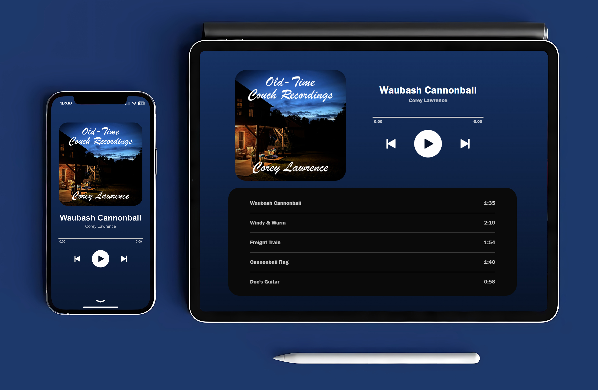

# Corey Lawrence Music Web App

Welcome to my personal acoustic music app! This progressive web app (PWA) provides an immersive, responsive experience for listening to my guitar recordings. Designed with simplicity, fluid gestures, and mobile-first principles, it lets you stream and enjoy tracks seamlessly from any device.

---

## Live URL
🎵 **[https://music.coreylawrence.me](https://music.coreylawrence.me)**

---

## Screenshots

---

## Features & Highlights

### 🎸 Acoustic Guitar Recordings
- **Waubash Cannonball** (1:35)
- **Windy & Warm** (2:19)
- **Freight Train** (1:54)
- **Cannonball Rag** (1:40)
- **Doc's Guitar** (0:58)

### 📱 Modern iOS PWA & UI Enhancements
- **Seamless Edge-to-Edge Design**: Full `viewport-fit=cover` integration with safe-area insets (`env(safe-area-inset-top)` / `bottom`), blending the midnight blue gradient naturally under the iPhone notch, dynamic island, and home indicator bar.
- **Fluid Bottom Sheet Drawer**: Custom bottom drawer for the tracklist with spring physics, touch swipe-down-to-close gesture, backdrop blur, and dual-pane layout on desktop/tablet.
- **Animated Equalizer & Track Feedback**: Live visual wave indicator on the actively playing track.
- **Precision Scrubber**: Full touch and pointer-drag scrubber with visual thumb scaling, real-time timestamp scrub preview, and glitch-free audio seeking.
- **Shuffle & Repeat**: Full playback cycle modes (Repeat Off, Repeat All, Repeat One) and Fisher-Yates shuffle.

### 🎧 Audio Engine & Lock Screen Controls
- **MediaSession API Integration**: Complete native lock screen, notification center, and CarPlay/headphone integration with high-resolution artwork, scrubbing position sync, and track navigation.
- **Reliable iOS Background Playback**: Single robust audio pipeline with initial silent audio unlock to guarantee uninterrupted playback and background streaming.
- **Offline PWA Capabilities**: Built with a dedicated Service Worker caching app shell and audio assets for offline listening.

---

## Technology Stack
- **JavaScript (ES6+)**: Custom reactive audio engine, pointer scrubber, and drawer gestures.
- **HTML5 & CSS3**: Custom properties, glassmorphism (`backdrop-filter`), safe area insets, and responsive layout.
- **Service Worker API**: Offline asset caching.
- **MediaSession API**: Native OS media controls.
- **Hosting & Infrastructure**: Self-hosted on Linux with Nginx reverse proxy and Cloudflare Tunnel (`cloudflared`) with zero-trust edge HTTPS.

---

## License
Personal Project - © Corey Lawrence. All rights reserved.
